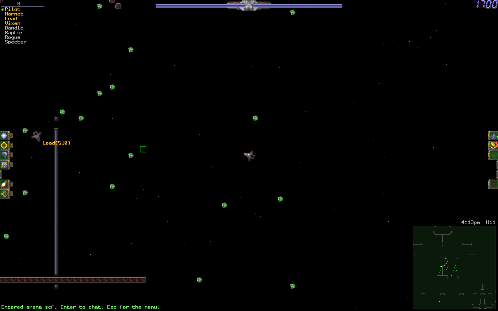

# oss-server

SubSpace is a top-down multiplayer space shooter from 1997. Ships drift; bullets and bombs
carry your momentum with them; a map is 1024×1024 tiles of asteroid and wall with flags to
take and a team to take them from. When the publisher walked away, the players kept the game
running themselves — and they still are, on a client called Continuum and on *zones*, the
servers that host the arenas.

**`oss-server` is a zone.** It is a from-scratch Rust implementation of a SubSpace/Continuum
server that follows ASSS — the server most zones have run for twenty years — closely enough
to take an existing zone directory and run it unchanged: the same `.conf` files, the same
`.lvl` maps, the same module names, the same `?commands`. Point your players' existing
clients at it and they should not be able to tell, except that it is one process, it tells
you what it is doing, and it has a metrics endpoint.



*The zone that ships in this repository, running, with eight clients in it.*

## The project

| Repository | What it is | Licence |
|---|---|---|
| [oss-core](https://github.com/DangerMouseUK/oss-core) | The shared half: packets, transport, map and settings formats, physics, and a conformance suite anyone can run | MIT |
| **oss-server** — you are here | The zone server | GPL-2.0-or-later |
| [oss-client](https://github.com/DangerMouseUK/oss-client) | The game client, plus a headless bot | GPL-2.0-or-later |

## Run it

`oss-server` uses the shared crates in [oss-core](https://github.com/DangerMouseUK/oss-core)
as a **sibling checkout**, so clone both:

```sh
git clone https://github.com/DangerMouseUK/oss-core
git clone https://github.com/DangerMouseUK/oss-server
cd oss-server
cargo run --release
```

With no arguments it runs its bundled default zone — the ASSS 1.4.4 sample zone, compiled
into the binary, so there are no files to put anywhere — on UDP port 5000, with the ping port
on 5001. You are now a zone. Connect with [oss-client](https://github.com/DangerMouseUK/oss-client)
or with any VIE client or bot core. (Continuum clients need a cipher module this repository
does not ship — see [below](#what-works-and-what-does-not).)

To see it answer without installing a client, run some headless bots at it from an
`oss-client` checkout:

```sh
cargo run --release -p oss-bot -- --server 127.0.0.1:5000 --ship 1 --count 3 --fly --chat "hello"
```

```
[oss-bot1] connected (vie)
[oss-bot1] logged in
[oss-bot1] entering arena as pid 0
[oss-bot1] downloading map smallmap.lvl (crc b2fb5159)
[oss-bot1] in the arena with 3 player(s)
[oss-bot1] chat(2) oss-bot2> hello
```

### Your own zone

`cargo run --release` leaves the binary at `target/release/oss-server`; the examples below
call it by name.

```sh
oss-server --zone <dir>        # run an ASSS-style zone directory, unchanged
oss-server --init-zone <dir>   # write the bundled zone to disk as a starting point
oss-server --bind 0.0.0.0:6000 --log "info,net=debug" --json
```

The config reader is ASSS's: `#include`, sections, per-arena overrides and all. `?commands`,
`conf/modules.conf`, `conf/staff.conf`, `arenas/<name>/arena.conf` work the way your zone
already expects. Modules ASSS has that this server does not are listed as `not implemented`
in the bundled `conf/modules.conf`, so you can see at a glance what you would lose.

### Operations

Uncomment `[Admin] Listen` in `conf/global.conf` (and set `[Admin] Token` if it is not on
loopback) for a JSON API and Prometheus metrics:

```ini
[ Admin ]
Listen = 127.0.0.1:5080
```

```sh
curl http://127.0.0.1:5080/api/status
```

```json
{"uptime_seconds":10,"players":1,"playing":1,"arenas":1,"modules":34}
```

`/metrics` is Prometheus text; `/api/players`, `/api/arenas` and `/api/modules` list the
live state; `POST /api/message`, `/api/players/{pid}/kick`, `/api/reload` and
`/api/modules/{name}` act on it; `GET /api/events` is a WebSocket stream of logins, arena
changes, kills, public chat and anti-cheat findings. Logs are `tracing`, plain or `--json`.

### A local user database

`oss-biller` is a small SSC-compatible billing server backed by SQLite, for private and test
zones: accounts, play time, banners, scores, `?chat` channels, squads and messages between
zones.

```sh
cargo run --release -p oss-biller -- --bind 127.0.0.1:1850 --db biller.db --password <pw>
```

Point the zone at it in `conf/global.conf` (`[Billing] IP`, `Port`, `Password`, `ServerID`,
`ServerName`) and load `billing_ssc` in `conf/modules.conf`.

## Why you would trust it

A claim here names its evidence.

**A real Continuum client has played on it.** A genuine Continuum 0.40 binary logged in,
entered an arena, drew the zone and flew for about 96 seconds across five sessions, with no
kick and no checksum complaint — using a private module for Continuum's key exchange, which
is *not* in this repository and will not be. **An unmodified, prebuilt MERVBot 4.6** —
a third party's bot core, not recompiled — completed a full session over VIE: login, arena,
news and map download, security challenge, chat, and position packets both ways.
[docs/interoperability.md](docs/interoperability.md) has the detail, including what each of
those runs did *not* cover.

**The client settings packet is checked against ASSS's own, bit by bit.** S2C `0x0F` is 1,428
bytes of bit-packed arena settings, and one wrong bit gives a client that plays subtly
differently from everybody else's. ASSS 1.4.4's `clientset.c`, compiled unmodified, built the
packet for two real configurations; `crates/oss-server/tests/asss_vectors.rs` checks 846
named settings' offsets and values and seven settings checksums against it on every test run,
and rebuilds the whole packet byte-for-byte when an ASSS zone directory is available.

**The game logic has vectors too, not just the packets.** 28 fixture files in
`crates/oss-server/tests/fixtures/asss-vectors/` are transcripts from ASSS 1.4.4 modules
compiled unmodified — kill points, flag rewards, KOTH, turf reward, prize weights, soccer
goals, bricks, banners, the chat flood limiter, lag aggregation, the game timer, `?buy`,
arena placement, billing and directory traffic. Each file's header names the ASSS source file
it came from.

**The performance budget is measured and the result is partly negative.**
[docs/performance.md](docs/performance.md) reports 500 players in one arena: the zone's game
logic costs 6.7% of one core and the transport 5.3%, about **12% together**, against a 20%
budget — over a whole map. In a *crowded* arena the same 500 players cost about 27% with VIE
and about 35% with OpenSec, and **the budget does not close**. That is written down rather
than rounded away, with the method, the machine, the paired control runs and two withdrawn
claims from earlier measurements that turned out to be the machine rather than the zone. CI
gates the case that passes and deliberately leaves the crowded one ungated.

**It is a library first.** Everything the server does is a module registered at startup, so a
private or third-party build links the library, adds its own modules — a cipher, a security
checker, a billing client — and runs without patching this repository.
[docs/architecture.md](docs/architecture.md) describes the module, interface, event and
packet-handler API, and the transport and security hooks.

## What works, and what does not

**Working.** Arenas and arena attach/detach, the freq manager, ships and weapons with
server-side plausibility checks, kills and scoring, flags (warzone and turf), balls and
soccer, KOTH, bricks, prizes and `?buy`, banners, chat with the ASSS flood rules and the
obscene filter, private and channel chat, chatnet, the `?command` set with capability groups,
bans and `?passwd`, persistence, LVZ objects, map and news download, lag data and `?lag`,
periodic and turf rewards, the game timer, zone registration with
directory servers, SSC billing, hot config reload, module load/unload at run time, the admin
API and metrics. 43 modules in the tree — the bundled zone loads 34 of them — and the ones
ASSS has that this does not are named in `conf/modules.conf`.

**Not here, and not coming here: Continuum's own encryption.** Continuum's key expansion is
not public, and this project does not reverse-engineer it or carry it — a deliberate
licensing and community decision. The consequence is plain: a build of these repositories
cannot *join* a zone that requires Continuum encryption, and a Continuum client can only play
*here* if the operator supplies that module themselves. What this repository provides is the
hook — register an `oss_net::Acceptor` and `oss_net::Cipher` from your own module and nothing
else needs to change. VIE encryption (the one that is public, and in ASSS) and
[OpenSec](https://github.com/DangerMouseUK/oss-core/blob/main/docs/protocol/opensec.md) both
work out of the box.

**Not done yet: packaging.** There is no container image, no installer, no release binary and
no crates.io publication. Today the only way to run it is to build it from source, as above.

**Not proven yet.** The 500-player figures come from a soak harness, not from 500 real
people; a crowded 500-player arena is over budget (above). Only the parts listed in
[docs/interoperability.md](docs/interoperability.md) have met real third-party software, and
each row there says what it did not cover.

## Contributing

Issues and pull requests are welcome. The most useful thing you can bring is a behavioural
difference from ASSS or subgame with evidence behind it — a config that produces different
settings, a command that answers differently, a packet captured from the original server. The
project's habit is that the source of a claim gets written down next to it.

Before sending a change, run all four:

```sh
cargo fmt
cargo clippy --workspace --all-targets -- -D warnings
cargo test --workspace
RUSTDOCFLAGS="-D warnings" cargo doc --workspace --no-deps --all-features
```

`cargo fmt` **without** `--all` here: `--all` takes its package list from `cargo metadata`,
which includes the sibling `../oss-core` checkout, and would rewrite that repository in
place. The doc gate is not optional and the other three do not stand in for it.

## Licence

GPL-2.0-or-later (see [`LICENSE`](LICENSE)), matching ASSS, whose behaviour this server
follows and whose source may be ported into it. The split across the three repositories is
deliberate: [oss-core](https://github.com/DangerMouseUK/oss-core) is MIT so that anyone's
bot, tool or alternative client can build on it whatever licence they use, while the server
and client are GPL.

The bundled zone under `zone/` comes from the ASSS 1.4.4 distribution (GPL-2.0-or-later, like
this repository) except where a file says otherwise; `zone/README.md` records every change
and which files are this project's own.

SubSpace and Continuum are the names of the original games; this project is an independent,
compatible implementation and is not affiliated with their authors.
